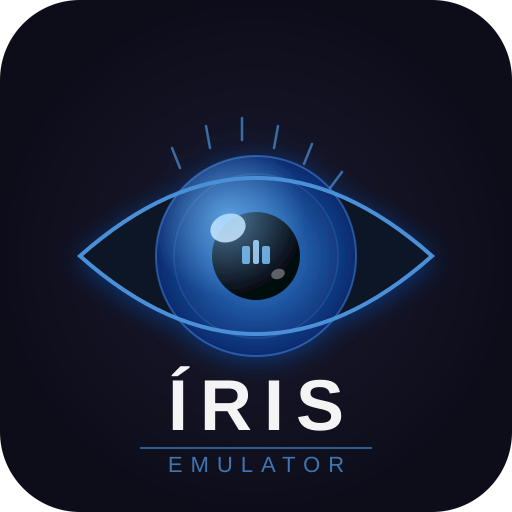

# Íris Emulator

<p align="center">
  
</p>

<p align="center">
  <b>Multi-system Atari emulator — Atari 2600 + Atari Lynx + Atari Jaguar</b><br>
  Built with C++17 · Qt 6 · SDL2 · Gearlynx engine<br>
  Developed by <b>Gorigamia</b> &amp; <b>Aleister93MarkV</b> · Open Source · Constantly updated
</p>

<p align="center">
  <a href="https://github.com/Adoregabriel2005/iris-emulator/releases/tag/v1.18.2">
    
  </a>
  
  
  
  
</p>

---

## v1.18.2 — Jaguar fixes

- 30 FPS presentation by default, with the console clock kept at normal NTSC/PAL speed.
- Real stereo audio output, buffered playback and audio reopening after Reset.
- DSP interrupt-return fix for Wolfenstein 3D and object-processor fix for clipped Super Burnout text.
- Independent Jaguar keyboard bindings and regression tests for timing, input, audio and rendering.
- Buffered 48 kHz stereo output, audio restored after Reset, and visible FPS/speed counters.

[Tested Jaguar games and current limitations](docs/JAGUAR_COMPATIBILITY.md) are listed below; the complete per-file audit is also available.

See [release notes](docs/RELEASE-v1.18.2.md) and [build instructions](docs/BUILDING.md). Compatibility remains incomplete; no ROMs or personal saves are included in the Windows package.

## What is Íris?

Íris is an open source multi-system Atari emulator that runs **Atari 2600**, **Atari Lynx**, and **Atari Jaguar** games on modern Windows hardware. The interface is inspired by **PCSX2**, **DuckStation**, and **Dolphin Emulator** — clean, professional, and easy to use without sacrificing power user features.

The project is in **active development** and receives constant updates. New mappers, better game compatibility, Jaguar improvements, and quality of life features are always in progress.

> **ROMs and BIOS files are NOT included and cannot be provided.**
> You must own the original hardware to legally use ROM files.
> The Atari Lynx Boot ROM (`lynxboot.img`) must be obtained from your own Lynx hardware.

---

## Platform Support

| Platform | Status |
|---|---|
| Windows 10 64-bit | ✅ Supported |
| Windows 11 64-bit | ✅ Supported |
| Linux | ⚠️ Not officially supported yet | Version in Development
| macOS | ❌ Not supported |

> **Linux contributors welcome!**
> The codebase uses Qt6, SDL2, OpenGL and CMake — all cross-platform. Pull requests are very welcome. The main things that would need attention are the build system paths, icon theme loading, and SDL audio device enumeration.

---

## Credits

This emulator would not exist without the work of these incredible people and projects.

### Developers
- **Gorigamia** — Lead developer, Atari 2600 core, UI, architecture
- **Aleister93MarkV** — Co-developer, testing, contributions

### Atari 2600 — Hardware History
The **Atari 2600** (originally Atari VCS) was developed by **Atari, Inc.**, under the leadership of engineer **Jay Miner** — who later went on to design the Amiga chipset. Released in 1977, it became one of the best-selling consoles of all time. The 2600 core was built from scratch, heavily informed by the **Stella** emulator team and the **AtariAge** community's decades of reverse engineering work on the TIA, RIOT, and 6507 chips.

### Atari Lynx — Hardware History
The **Atari Lynx** was originally developed by the software company **Epyx** in 1987, initially named *"Handy Game"*. The principal designers were **Dave Needle** and **R.J. Mical**, known for their work on the Amiga computer. Due to financial difficulties at Epyx, **Atari Corp.** took over production and launched the Lynx in 1989 — making it the world's first color handheld console. The Lynx core is powered by **[Gearlynx](https://github.com/drhelius/Gearlynx)** by **Ignacio Sanchez (drhelius)** — without Gearlynx, Lynx support in Íris would not be possible.

### Atari Jaguar — Hardware History
The **Atari Jaguar** was developed primarily by **Flare Technology** (Martin Brennan and John Mathieson) in partnership with Atari Corp. Released in 1993, it was marketed as the first 64-bit home console. The Jaguar core is powered by the **Virtual Jaguar** engine by Shamus / James L. Hammons.

### Third-Party Engines & Libraries
- **[Gearlynx](https://github.com/drhelius/Gearlynx)** by Ignacio Sanchez (drhelius) — Atari Lynx core (GPL-3.0)
- **Virtual Jaguar** by Shamus / James L. Hammons — Atari Jaguar core (GPL-3.0)
- **Stella** team & **AtariAge** community — 2600 documentation
- **Qt 6** — UI framework
- **SDL2** — Audio & input
- **VST3 SDK** by Steinberg — Audio plugin support
- **discord-rpc** — Discord Rich Presence

### Interface Inspiration
- **PCSX2** — Overall layout, settings dialog, game list, setup wizard style
- **DuckStation** — Toolbar style, overlay menu
- **Dolphin Emulator** — Save state slots, cover art grid

---

## Features

### Atari 2600
- Cycle-accurate 6507 CPU (all illegal opcodes)
- TIA chip at color-clock level — 15 collisions, HMOVE, WSYNC, VDEL, NUSIZ
- 2-channel audio with 16 waveforms
- RIOT 6532 (timers + I/O)
- NTSC / PAL / SECAM support
- Mappers: None (≤4KB), F8 (8KB), F6 (16KB), F4 (32KB), E0 (Parker Bros), F8SC/F6SC/F4SC (Superchip), 3F, 3E, FA, FE

### Atari Lynx (powered by Gearlynx)
- WDC 65C02 CPU @ 4 MHz
- Mikey chip — 8 timers, 4-channel stereo audio, display DMA
- Suzy sprite engine with scaling
- Math coprocessor (multiply/divide)
- 160×102 4bpp display with palette
- LNX cartridge format + HLE boot (no BIOS required for homebrew)
- Boot ROM support (`lynxboot.img`) for commercial games

### Atari Jaguar (powered by Virtual Jaguar)
- Motorola 68000 @ 13.295 MHz (main CPU)
- Tom chip — GPU, blitter, object processor
- Jerry chip — DSP, audio, timers
- NTSC / PAL support
- Cartridge format `.j64` / `.jag`
- **RF Cable filter** — chroma bleed, animated dot crawl, luminance noise, vignette
- **S-Video filter** — sharp luma, soft chroma (Y/C separation), CRT scanlines, saturation boost
- **Upscaling** — Native / 480p / 720p / 1080p
- **Aspect ratio** — Auto / 4:3 / 16:9

### Audio — VST3 Plugin Chain
- Real-time VST3 plugin processing on emulator audio output
- Enable/disable chain toggle (bypass without removing plugins)
- Double-click plugin to open its native graphical editor
- Drag to reorder plugins in the chain
- Master gain slider (0–200%)
- Persisted chain (saved/loaded with settings)

### Interface
- Game list with cover art (table + grid view)
- Built-in cover art downloader (TheGamesDB)
- **Setup wizard** on first launch (PCSX2-style, multi-page with sidebar)
- **Returning user greeting** with "don't show again" option
- **About dialog** with Credits, License (GPL-3.0) and hardware history tabs
- CRT Scanlines, CRT Full, LCD Grid, LCD Ghosting, RF Cable, S-Video filters
- Dark theme (inspired by PCSX2)
- Fully remappable controls — keyboard and gamepad
- **10 save state slots** — slot 1 = quick save (F5/F7), slots 2–10 = manual
- Save state folders auto-created on first launch (`savestates/quick/` + `savestates/manual/`)
- Drag & drop ROM loading
- Fullscreen support
- Pause overlay menu
- Discord Rich Presence (game name, console, time playing, status)
- Debug window (F12)

---

## Game Compatibility

### Compatibility Summary

#### Atari 2600

| Category | Count | Percentage |
|---|---|---|
| ✅ Fully playable — no issues | ~29 tested titles | ~65% of tested library |
| ⚠️ Opens but has graphical/timing bugs | ~4 tested titles | ~9% of tested library |
| ❌ Does not open / crashes | ~12 titles (missing mappers) | ~26% of tested library |
| 🏆 100% completable | Pitfall!, River Raid, Space Invaders, Pac-Man, Enduro, Adventure, Asteroids, Missile Command | ~18% of tested library |

> The 2600 library has ~900 commercial titles. The missing mapper list (3F, 3E, FE, FA, F0, AR, DPC, DPC+, UA, CV) blocks roughly 15–20% of the full commercial library.

#### Atari Lynx

| Category | Count | Percentage |
|---|---|---|
| ✅ Fully playable | ~13 tested titles | ~50% of tested library |
| ⚠️ Opens with graphical/sprite bugs | ~4 tested titles | ~15% of tested library |
| ❌ Does not open / black screen | ~9 titles | ~35% of tested library |
| 🏆 100% completable | California Games, Chip's Challenge, Gates of Zendocon | ~12% of tested library |

> The Lynx core is in **alpha (~35%)** and improving with every release. Only ~26 titles have been tested out of ~73 commercial releases.

#### Atari Jaguar

| Category | Count | Percentage |
|---|---|---|
| ✅ Fully playable | ~8 tested titles | ~40% of tested library |
| ⚠️ Opens with graphical/audio bugs | ~6 tested titles | ~30% of tested library |
| ❌ Does not open / crashes | ~6 titles | ~30% of tested library |
| 🏆 100% completable | Tempest 2000, Rayman (partial) | ~10% of tested library |

> The Jaguar core is experimental. Passing an opening test does not certify a complete game. Jaguar CD and some cartridge/homebrew formats remain unsupported.

---

### Atari 2600 — Works perfectly ✅

| Game | Status |
|---|---|
| Pitfall! | ✅ Perfect |
| River Raid | ✅ Perfect |
| Space Invaders | ✅ Perfect |
| Pac-Man | ✅ Perfect |
| Enduro | ✅ Perfect |
| Frostbite | ✅ Perfect |
| Atlantis | ✅ Perfect |
| Demon Attack | ✅ Perfect |
| Megamania | ✅ Perfect |
| Keystone Kapers | ✅ Perfect |
| Berzerk | ✅ Perfect |
| Adventure | ✅ Perfect |
| Combat | ✅ Perfect |
| Asteroids | ✅ Perfect |
| Missile Command | ✅ Perfect |
| Centipede | ✅ Perfect |
| Freeway | ✅ Perfect |
| Donkey Kong | ✅ Perfect |
| Frogger | ✅ Perfect |
| H.E.R.O. | ✅ Perfect |
| Solaris | ✅ Perfect |
| Jr. Pac-Man | ✅ Perfect |
| Crystal Castles | ✅ Perfect |
| Montezuma's Revenge | ✅ Perfect |
| Q*bert | ✅ Perfect |
| Popeye | ✅ Perfect |
| Spider-Man | ✅ Perfect |
| Star Wars: The Empire Strikes Back | ✅ Perfect |
| The Activision Decathlon | ✅ Perfect |

### Atari 2600 — Has issues ⚠️

| Game | Issue |
|---|---|
| Cosmic Ark | Stars don't appear (timing edge case) |
| Yars' Revenge | Shield flicker more intense than hardware |
| BurgerTime | E7 mapper simplified — some graphics glitch |
| Masters of the Universe | Minor visual artifacts |

### Atari 2600 — Not working ❌

| Game | Reason |
|---|---|
| Pitfall II | DPC mapper not implemented |
| Miner 2049er | 3F mapper not implemented |
| Robot Tank | FA mapper not implemented |
| Supercharger games | AR mapper not implemented |
| Kaboom! | Paddle controller not implemented |
| Night Driver | Paddle controller not implemented |
| Indy 500 | Driving controller not implemented |
| Decathlon (paddle) | Paddle controller not implemented |

**Missing mappers:** 3F, 3E, FE, FA, F0, AR, DPC, DPC+, UA, CV

---

### Atari Lynx — Works well ✅

| Game | Status |
|---|---|
| California Games | ✅ Playable |
| Chip's Challenge | ✅ Playable |
| Gates of Zendocon | ✅ Playable |
| Xenophobe | ✅ Playable |
| Batman Returns | ✅ Playable |
| Lemmings | ✅ Playable |
| Toki | ✅ Playable |
| Alien vs Predator (Prototype) | ✅ Playable |
| Awesome Golf | ✅ Playable |
| Double Dragon (Telegames) | ✅ Playable |
| Paperboy | ✅ Playable |
| RoadBlasters | ✅ Playable |
| Simple homebrew titles | ✅ Playable |

### Atari Lynx — Has issues ⚠️

| Game | Issue |
|---|---|
| Gauntlet: The Third Encounter | Heavy graphical bugs, mostly unplayable |
| Games with heavy sprite overlap | Collision detection incomplete |
| Games using ComLynx | Multiplayer not implemented |
| Games with sprite tilt/stretch | Advanced sprite transforms missing |

> **Note:** Only a portion of the Lynx library has been tested. If a game not listed here runs well or has issues, feel free to open an issue or pull request.

### Atari Lynx — Not working ❌

| Game | Reason |
|---|---|
| Games requiring CPUSLEEP | Not implemented |
| Games using shadow/XOR/boundary sprites | Advanced sprite types missing |

---

### Atari Jaguar — supported/tested games in v1.18.2

Jaguar support is experimental. The following games have targeted validation; the scope column states what was actually checked.

| Game | Current result | Verified scope |
|---|---|---|
| **Doom** | 3D rendering, normal sound and speed confirmed | User confirmation plus real WASAPI audio; 30 FPS presentation |
| **Wolfenstein 3D** | Intermittent boot hang fixed | 24 initial RAM states passed boot; extended demo and audio checks |
| **Super Burnout** | Menu text clipping fixed; race renders | Menu comparison, race rendering, audio after Reset and PAL timing |
| **Rayman** | Opening and audio regression passed | Timed startup and non-silent audio output; full game not certified |

Additional titles that completed a 600-frame opening test with an image include **Alien vs Predator, Atari Karts, Attack of the Mutant Penguins, Checkered Flag, Club Drive, Cybermorph, Defender 2000, I-War, Iron Soldier, Missile Command 3D, NBA Jam TE, Pinball Fantasies, Power Drive Rally, Super Cross 3D, Syndicate, Tempest 2000, Theme Park, Ultra Vortek, Val d’Isère Skiing & Snowboarding, Zool 2 and Zoop!** Their gameplay and audio are not certified by that opening test.

The full audit covers **139 files: 91 completed, 44 rejected by the loader and 4 timed out**. Some completed tests ended on black/solid-color images, so these totals are not counts of fully playable games. The audit predates final audio packaging and includes demos and alternate dumps.

See the [complete Jaguar compatibility list](docs/JAGUAR_COMPATIBILITY.md) and [text-only results CSV](docs/JAGUAR_OPENING_AUDIT.csv) for every tested file and its observed outcome.

### Atari Jaguar — remaining issues and unsupported software

| Game / category | Current limitation |
|---|---|
| Brutal Sports Football | Supplied image rejected by the loader before execution |
| Flip Out, Pitfall: The Mayan Adventure, Raiden, Ruiner Pinball, White Men Can't Jump | Last opening capture black/solid; gameplay unvalidated, requiring further investigation |
| Kasumi Ninja, Val d’Isère Skiing, Zool 2, Bubsy | Historical graphics reports; affected scenes not revalidated after the fixes |
| Iron Soldier | Historical frame-drop reports; sustained performance not certified |
| Jaguar CD, including Battlemorph and Blue Lightning CD | CD-ROM not implemented in this frontend |
| Other formats / unlisted games | No full compatibility claim; check the audit and report reproducible failures |


---

## Hardware Requirements

Frame stepping runs on the UI/emulation thread, while SDL handles host audio playback. The current display widget uses Qt/QPainter for image presentation and filters; Qt OpenGL libraries remain build dependencies. The tables below are historical hardware guidance, not newly verified v1.18.2 minimum requirements.

### Atari 2600 — Minimum (60 FPS stable)

| Component | Minimum | Recommended |
|---|---|---|
| **CPU (Intel)** | Core 2 Duo E6300 @ 1.86 GHz (2006) | Core i3-2100 @ 3.1 GHz (2011) |
| **CPU (AMD)** | Athlon 64 X2 3800+ @ 2.0 GHz (2006) | FX-6300 @ 3.5 GHz (2012) |
| **RAM** | 2 GB DDR2-667 | 4 GB DDR3-1333 |
| **GPU (dedicated)** | NVIDIA GeForce 8400 GS (2007) | NVIDIA GTX 550 Ti (2011) |
| **GPU (dedicated AMD)** | AMD Radeon HD 2400 (2007) | AMD Radeon HD 6790 (2011) |
| **GPU (integrated)** | Intel GMA X4500 — G45 chipset (2008) | Intel HD Graphics 2000 — Sandy Bridge (2011) |
| **Storage** | 80 MB | 200 MB (with covers) |
| **OS** | Windows 10 64-bit | Windows 10 / 11 64-bit |
| **Display** | 1024×768 | 1280×720 or higher |
| **OpenGL** | 3.3 Core Profile | 3.3 Core Profile |

### Atari Lynx — Minimum (75 FPS stable)

| Component | Minimum | Recommended |
|---|---|---|
| **CPU (Intel)** | Core 2 Duo E8400 @ 3.0 GHz (2008) | Core i3-2100 @ 3.1 GHz (2011) |
| **CPU (AMD)** | Phenom II X2 550 @ 3.1 GHz (2009) | FX-6300 @ 3.5 GHz (2012) |
| **RAM** | 2 GB DDR2-800 | 4 GB DDR3-1333 |
| **GPU (dedicated)** | NVIDIA GeForce 8400 GS (2007) | NVIDIA GTX 550 Ti (2011) |
| **GPU (dedicated AMD)** | AMD Radeon HD 2400 (2007) | AMD Radeon HD 6790 (2011) |
| **GPU (integrated)** | Intel GMA X4500 — G45 chipset (2008) | Intel HD Graphics 2000 — Sandy Bridge (2011) |

### Atari Jaguar — 30 FPS presentation, normal console speed

Jaguar defaults to **30 FPS presentation**, with approximately **59.94 emulated updates/s in NTSC or 50 in PAL** to preserve normal speed and audio. The on-screen counter shows presentation FPS, console frequency and speed percentage separately. Audio defaults to stereo 48 kHz and a 128 ms buffer; existing volume preferences are retained.

Hardware figures below are historical guidance, not new v1.18.2 benchmarks. Emulation and display-filter costs depend on the game and settings.

| Component | Minimum | Recommended |
|---|---|---|
| **CPU (Intel)** | Core i3-2100 @ 3.1 GHz — Sandy Bridge (2011) | Core i5-3470 @ 3.2 GHz — Ivy Bridge (2012) |
| **CPU (AMD)** | FX-4300 @ 3.8 GHz (2012) | FX-8350 @ 4.0 GHz (2012) |
| **RAM** | 4 GB DDR3-1333 | 8 GB DDR3-1600 |
| **GPU (dedicated)** | NVIDIA GeForce GTX 460 (2010) | NVIDIA GTX 760 (2013) |
| **GPU (dedicated AMD)** | AMD Radeon HD 6850 (2010) | AMD Radeon R9 270 (2013) |
| **GPU (integrated)** | Intel HD Graphics 4000 — Ivy Bridge (2012) | Intel HD Graphics 4600 — Haswell (2013) |
| **OpenGL** | 3.3 Core Profile | 3.3 Core Profile |

> Check the speed percentage on your machine. A 30 FPS presentation limit does not compensate for a CPU that cannot emulate a game in real time.

---

## Default Controls

| Action | 2600 Keyboard | 2600 Gamepad | Lynx Keyboard | Lynx Gamepad | Jaguar Keyboard | Jaguar Gamepad |
|---|---|---|---|---|---|---|
| Directions | Arrow keys | D-pad / Left stick | Arrow keys | D-pad / Left stick | Arrow keys | D-pad / Left stick |
| Button A / Fire | Z | A | Z | A | Z | A |
| Button B | — | — | X | B | X | B |
| Button C | — | — | — | — | C | X |
| L Shoulder | — | — | A | LB | — | — |
| R Shoulder | — | — | S | RB | — | — |
| Option | — | — | — | — | O | LB |
| Select | Tab | Back | — | — | — | — |
| Reset / Start / Pause | Backspace | Start | Enter | Start | Enter | Start |
| Quick Save | F5 | — | F5 | — | F5 | — |
| Quick Load | F7 | — | F7 | — | F7 | — |
| Pause overlay | Escape | — | Escape | — | Escape | — |

Jaguar keypad defaults to digits 0–9, `*` and `#`. Each Jaguar action has its own saved binding. All bindings are remappable in Settings → Controls.

---

## Running (Windows)

1. Download the latest release from the [Releases page](https://github.com/Adoregabriel2005/iris-emulator/releases)
2. Extract the zip to any folder
3. Run `irisemulator.exe`
4. The setup wizard will guide you through adding a ROM folder
5. Double-click any game to play

**Requirements:**
- Windows 10 or 11 64-bit
- GPU with OpenGL 3.3 Core Profile (GeForce 8 series / Radeon HD 2000 / Intel HD 2000 or newer for 2600+Lynx — GTX 460 / HD 6850 / Intel HD 4000 or newer for Jaguar)
- [Visual C++ Redistributable 2022 x64](https://aka.ms/vs/17/release/vc_redist.x64.exe) ← install this if the emulator doesn't open
- Discord desktop app (optional, for Rich Presence)

**Atari Lynx BIOS:** Place `lynxboot.img` next to the `.exe` or configure the path in Settings → Lynx Controls → Boot ROM file. ROMs with the HLE magic byte will boot without a BIOS.

---

## Build from Source

### Requirements
- Windows 10/11 64-bit
- [Visual Studio 2022](https://visualstudio.microsoft.com/) with C++ workload
- [Qt 6.8+](https://www.qt.io/download) (Widgets, Svg, Network, OpenGL, OpenGLWidgets)
- [SDL2](https://github.com/libsdl-org/SDL/releases)
- [vcpkg](https://github.com/microsoft/vcpkg) with `discord-rpc:x64-windows`
- CMake ≥ 3.16

### Steps

```powershell
git clone https://github.com/Adoregabriel2005/iris-emulator.git
cd iris-emulator

cmake -S . -B build -DCMAKE_TOOLCHAIN_FILE="D:/vcpkg/scripts/buildsystems/vcpkg.cmake"
cmake --build build --config Release

# Output: build/Release/irisemulator.exe
```

---

## License

Íris Emulator is open source software licensed under the **GNU General Public License v3.0**.
See [LICENSE](LICENSE) for details.

The Gearlynx engine is copyright © 2025 Ignacio Sanchez, licensed under GPL-3.0.
The Virtual Jaguar engine is copyright © its respective authors, licensed under GPL-3.0.

---

## About

Developed by **Gorigamia** & **Aleister93MarkV** · Inspired by PCSX2, DuckStation, and Dolphin Emulator
